# ⚡ Awesome RAG & LLM Application Tools 🛠️

**A Curated Directory of SaaS Platforms & Production-Ready Open-Source Frameworks for Retrieval-Augmented Generation (RAG), Autonomous AI Agents & LLM Application Scaffolding.**

  
  
  
  
  
  

---

## 📖 Overview & SEO Summary

Welcome to the definitive index of **RAG (Retrieval-Augmented Generation) & LLM Application Tools**! Whether you are an AI engineer architecting production-grade agentic workflows, an enterprise engineering team enforcing data sovereignty over internal knowledge bases, or an indie developer assembling a full-stack generative AI app, this repository curates the best visual workflow builders, code-first frameworks, and managed SaaS platforms available today.

### 🎯 Key Focus Areas
- 🧩 **Visual Flow & Agent Builders**: Drag-and-drop canvases (Dify, Flowise, Langflow, Voiceflow) for chaining LLMs, vector memories, and external tools without glue code.
- 🚀 **Full-Stack Application Scaffolding**: Fast-track production deployment CLIs and templates (create-llama, Cognita, Verba).
- 🧠 **Composable RAG & Multi-Agent Frameworks**: Purpose-built retrieval and stateful orchestration engines (LangChain, LangGraph, LlamaIndex, Haystack, AutoGen, CrewAI, DSPy).
- 🔍 **Enterprise Knowledge Bases & Observability**: Open-source search engines, deep document parsers, and tracing platforms (RAGFlow, Onyx, Khoj, Langfuse).

---

## 📑 Table of Contents
- [🌐 Sector Overview & Market Dynamics](#-sector-overview--market-dynamics)
- [☁️ SaaS & Hosted Platforms](#️-saas--hosted-platforms)
- [💻 Open-Source GitHub Projects](#-open-source-github-projects)
- [💡 Architectural Decision Guide](#-architectural-decision-guide)
- [🤝 How to Contribute](#-how-to-contribute)
- [⚠️ Disclaimer](#️-disclaimer)
- [📈 Star History](#-star-history)
- [💖 Support & Community](#-support--community)

---

## 🌐 Sector Overview & Market Dynamics

The dedicated global **Retrieval-Augmented Generation (RAG) platform market** is valued between **$1.9 billion and $4.0 billion (2025/2026)** and is projected to expand past **$43+ billion by 2033** at an extraordinary CAGR of **38%–45%**, while the broader enterprise **LLM application software market** is estimated at **$10 billion to $13 billion**.

The sector exhibits **moderate to high horizontal fragmentation across the technology stack**—unbundled into foundational LLMs, vector databases, multi-agent frameworks, document parsing engines, and observability tooling—alongside vertical fragmentation across regulated domains (BFSI, healthcare, legal tech). However, **intense consolidation and winner-take-most dynamics** are accelerating at the visual orchestration layer, evidenced by major enterprise acquisitions (e.g., **Workday acquiring Flowise** and **IBM acquiring DataStax/Langflow**) and unicorn funding rounds for framework pioneers like **LangChain ($1.25B valuation)**.

---

## ☁️ SaaS & Hosted Platforms

The following commercial SaaS solutions provide fully managed workspaces, pre-configured pipelines, enterprise security (SOC 2, HIPAA, SSO/SAML), and managed compute for RAG and AI agent development.

> **Sorted in descending order by Company Size (Valuation / Market Capitalization / Capital Backing):**

| 🏢 Platform / Product | 📊 Company Size (Valuation / Revenue) | 💳 Pricing (Starting Paid Tier) | 🎁 Free Tier Limits (Exact Allowances) | ✨ Key Highlights & Specialization |
| :--- | :--- | :--- | :--- | :--- |
| **[Flowise Cloud](https://flowiseai.com/)** | **Acquired by Workday** *(NASDAQ: WDAY, $65B+ Market Cap; ~$1M ARR prior exit)* | **$35 / month** *(Starter Plan)* | **Free forever**: 2 flows/assistants, 100 predictions/month, 5 MB storage, community Discord support. | Drag-and-drop LangChain-powered workflow canvas; acquired by Workday to power enterprise HR and operational agent builders. |
| **[LangSmith](https://www.langchain.com/langsmith)** *(by LangChain)* | **$1.25 Billion Valuation** *(Series B Unicorn; $260M+ total venture funding)* | **$39 / seat / month** *(Plus Plan; $2.50 per 1k overage traces)* | **Free forever (Developer Plan)**: 1 user seat, 5,000 base traces/month, 14-day data retention, playground access. | Enterprise LLM tracing, prompt versioning, dataset curation, and end-to-end evaluation suite for LangChain & LangGraph agents. |
| **[Dify Cloud](https://dify.ai/)** *(by LangGenius)* | **$180 Million Valuation** *($30M Series Pre-A; ~$3.1M ARR, 2,000+ teams)* | **$59 / workspace / month** *(Professional Plan; or $49/mo billed annually)* | **Free forever (Sandbox Plan)**: 200 message credits (trial), 1 workspace, 1 member, 5 active apps, 50 MB knowledge base (max 50 files), 10 req/min limit. | Turnkey managed edition of the most popular open-source visual LLM application platform; includes Chatflows, agent plugins, and RAG pipelines. |
| **[Relevance AI](https://relevanceai.com/)** | **~$150M – $200M Est. Valuation** *($37M venture funding; $24M Series B led by BVP)* | **$29 / month** *(Pro Plan; or $19/mo billed annually)* | **14-day free trial**: 100 free workflow actions, 1 build project, and full access to test autonomous B2B workforce agents. | Autonomous B2B agent workforce builder with native multi-agent coordination, outbound calling, and CRM integration actions. |
| **[Voiceflow](https://www.voiceflow.com/)** | **$105 Million Valuation** *($35M+ funding; ~$10M–$15M ARR, 500k+ global teams)* | **$60 / editor / month** *(Pro Plan; or $50/mo billed annually)* | **Free forever (Starter Plan)**: Up to 2 agents, 100 monthly AI credits/messages, 50 knowledge base data sources, 1 concurrent voice call. | Collaborative no-code visual canvas for conversational AI, customer experience agents, omnichannel telephony, and interactive testing. |
| **[Vectara](https://vectara.com/)** | **~$80M – $100M Est. Valuation** *($53.5M venture funding; $25M Series A)* | **$100,000 / year** *(Enterprise SaaS deployment contract; pilots on request)* | **30-day free trial**: 10,000 free query/generation credits, full access to agent builder, neural retrieval APIs, and Boomerang embeddings. | Enterprise-grade "RAG-as-a-service" with built-in hallucination detection (HHEM), automated hybrid search reranking, and SOC 2 Type II compliance. |
| **[Haystack Enterprise](https://haystack.deepset.ai/)** *(by deepset)* | **~$75M – $90M Est. Valuation** *($46M funding; Series B backed by Balderton & GV)* | **$499 / month** *(Haystack Enterprise Starter tier with engineering support)* | **Free forever (Studio Plan)**: 1 workspace, 1 user, 100 pipeline hours, 50 files (max 10MB per file), 2 active development pipelines. | Managed production infrastructure for Haystack with continuous pipeline tracing, auto-scaling deployment replicas, and evaluation harnesses. |
| **[LlamaCloud](https://cloud.llamaindex.ai/)** *(by LlamaIndex)* | **~$60M – $75M Est. Valuation** *($28M funding; Series A led by Norwest & Greylock)* | **$50 / month** *(Starter Plan: 40,000 credits/mo, overages to $500/mo)* | **Free forever**: 10,000 credits/month (~1,000 standard parsed document pages), self-serve document extraction and agentic indexing. | Managed data ingestion and parsing platform (LlamaParse) with advanced layout-aware table extraction and managed RAG indexes. |
| **[Dust](https://dust.tt/)** | **~$50M – $65M Est. Valuation** *($45M funding; $40M Series B in 2026)* | **€29 (~$31) / seat / month** *(Pro Plan; includes 8,000 credits/seat/mo)* | **Free trial**: 500 lifetime credits, up to 3 custom agents, and native connectors to Slack, Notion, Google Drive, and GitHub. | Multiplayer enterprise AI agent workspace allowing team members to build, share, and govern contextual assistants connected to internal docs. |
| **[Stack AI](https://www.stack-ai.com/)** | **~$35M – $50M Est. Valuation** *($16M Series A; Y Combinator W23)* | **$190 / month** *(Team Starter Plan; or custom Enterprise contracts)* | **Free forever**: 500 workflow runs/month, 2 active projects, 1 user seat, and full access to 40+ pre-built enterprise connectors. | Enterprise workflow automation and back-office RAG builder designed for healthcare, banking, legal, and compliance-heavy automations. |

---

## 💻 Open-Source GitHub Projects

Curated open-source projects for self-hosting, developer scaffolding, and extensible RAG pipelines.

> **Sorted in descending order by GitHub Stars ⭐ (Real-time live badges link directly to each repo's stargazers):**

### 1. 🥇 [Dify](https://github.com/langgenius/dify) 
- **Primary Language**: TypeScript / Python | **License**: Modified Apache 2.0
- **Overview**: The most popular open-source LLM application development platform in the world. Combines an intuitive visual workflow builder, multi-agent frameworks, flexible RAG data pipelines, and prompt engineering studios into a single Docker-deployable stack.
- **Key Features**: v1.0 plugin architecture with model/tool extensibility, Agent Nodes for intelligent routing, knowledge base document parsing, and single-click REST API deployment.

### 2. 🥈 [Langflow](https://github.com/langflow-ai/langflow) 
- **Primary Language**: Python / React | **License**: MIT
- **Overview**: Dynamic visual IDE and runtime for building multi-agent AI workflows and RAG systems. Delivers complete source code access so developers can customize any node directly in Python.
- **Key Features**: Real-time component playground, native Model Context Protocol (MCP) server deployment (workflows become tools), desktop app for macOS/Windows, and deep integration with LangSmith and Langfuse.

### 3. 🥉 [LangChain / LangGraph](https://github.com/langchain-ai/langchain) 
- **Primary Language**: Python / TypeScript | **License**: MIT
- **Overview**: The industry standard for composable AI programming. With **LangGraph**, it enables cyclical, stateful, multi-agent orchestration with persistent memory and human-in-the-loop validation.
- **Key Features**: Massive ecosystem of 700+ integrations, deterministic execution graphs, time-travel debugging, and native production tracing via LangSmith.

### 4. 📄 [RAGFlow](https://github.com/infiniflow/ragflow) 
- **Primary Language**: Python | **License**: Apache 2.0
- **Overview**: Open-source RAG engine based on deep document understanding. Extracts content from unstructured complex PDFs, slides, and scanned tables with vision-based parsing.
- **Key Features**: Visual chunk preview with grounded citations, template-based chunking algorithms, hybrid vector/keyword retrieval, and multi-tenant self-hosting.

### 5. 🤖 [AutoGen](https://github.com/microsoft/autogen) 
- **Primary Language**: Python | **License**: MIT
- **Overview**: Microsoft's cutting-edge programming framework for agentic AI. Facilitates multi-agent conversation patterns, autonomous collaborative reasoning, and code execution environments.
- **Key Features**: Event-driven asynchronous architecture (AutoGen 0.4+), multi-agent human-in-the-loop collaboration, extensible tooling, and Dockerized code sandboxing.

### 6. 👥 [CrewAI](https://github.com/crewAIInc/crewAI) 
- **Primary Language**: Python | **License**: MIT
- **Overview**: Ultra-popular framework for orchestrating role-playing autonomous AI agents. Enables engineers to configure collaborative AI crews where agents assume distinct personas, delegate tasks, and share memory.
- **Key Features**: Role-based agent delegation, sequential & hierarchical task processes, structured tool calling, and seamless compatibility with LangChain and LlamaIndex tools.

### 7. 🧩 [Flowise](https://github.com/FlowiseAI/Flowise) 
- **Primary Language**: TypeScript | **License**: Apache 2.0
- **Overview**: Open-source drag-and-drop UI for assembling customized LLM flows, conversational agents, and RAG pipelines on top of LangChain.
- **Key Features**: Connect vector stores, document loaders, memory buffers, and LLMs like LEGO blocks; supports custom JavaScript/TypeScript code nodes, multi-agent systems, and production Docker deployment.

### 8. 🦙 [LlamaIndex](https://github.com/run-llama/llama_index) 
- **Primary Language**: Python / TypeScript | **License**: MIT
- **Overview**: The purpose-built data framework for indexing, parsing, and retrieving private enterprise data for LLM applications.
- **Key Features**: 160+ data connectors (LlamaHub), advanced routing, hierarchical indexing, rerankers, hybrid search algorithms, and agentic query engines.

### 9. 🧠 [Quivr](https://github.com/The-Vibe-Company/quivr) 
- **Primary Language**: Python / TypeScript | **License**: Apache 2.0
- **Overview**: Open-source "Second Brain" engine designed to ingest continuous unstructured streams of personal and enterprise information (PDFs, docs, audio, YouTube).
- **Key Features**: Multi-modal data ingestion, generative chat over private knowledge vaults, pluggable open-source LLMs (Ollama/vLLM), and shared workspace spaces.

### 10. 🎯 [DSPy](https://github.com/stanfordnlp/dspy) 
- **Primary Language**: Python | **License**: MIT
- **Overview**: Stanford's groundbreaking framework for *programming*—rather than prompting—foundation models. Replaces brittle prompt engineering with declarative modules and automated teleprompter optimizers.
- **Key Features**: Algorithmic prompt compiler, automatic few-shot example generation, metric-driven optimization, and modular RAG architectures.

### 11. 🔍 [Khoj](https://github.com/khoj-ai/khoj) 
- **Primary Language**: Python | **License**: AGPL-3.0
- **Overview**: An open-source, self-hostable AI personal second brain. Indexes local files, markdown notes, PDFs, web bookmarks, and org-mode documents with instant semantic search and offline LLM inference.
- **Key Features**: Desktop, mobile, and web apps; voice input support; integration with local models (Ollama) or frontier APIs; automated web research capabilities.

### 12. 🕸️ [GraphRAG](https://github.com/microsoft/graphrag) 
- **Primary Language**: Python | **License**: MIT
- **Overview**: Microsoft's modular graph-based Retrieval-Augmented Generation pipeline. Extracts knowledge graphs and entity communities from raw documents to answer complex global questions that naive RAG fails to resolve.
- **Key Features**: Hierarchical graph clustering (Leiden community detection), comprehensive global summarization, local entity search, and dataset generation.

### 13. 🪢 [Langfuse](https://github.com/langfuse/langfuse) 
- **Primary Language**: TypeScript / Python | **License**: MIT
- **Overview**: Open-source LLM engineering and observability platform. Delivers deep tracing, cost tracking, prompt versioning, and rigorous evaluation pipelines for production RAG and agent applications.
- **Key Features**: Zero-overhead OpenTelemetry-compliant tracing, automated and human-in-the-loop scoring, latency/cost analytics, and seamless ClickHouse backend scaling.

### 14. 💎 [Onyx](https://github.com/onyx-dot-app/onyx) *(formerly Danswer)* 
- **Primary Language**: Python / TypeScript | **License**: MIT
- **Overview**: Open-source enterprise search and RAG platform with turnkey connectors to 40+ workplace data repositories (Slack, Google Drive, Notion, Confluence, Jira, GitHub).
- **Key Features**: Granular document-level access permissions (RBAC), multi-LLM querying, custom assistant generation, and self-hosted Docker Compose & Helm chart deployment.

### 15. 🌾 [Haystack](https://github.com/deepset-ai/haystack) 
- **Primary Language**: Python | **License**: Apache 2.0
- **Overview**: Composable, enterprise-grade AI orchestration framework for building production RAG pipelines and context-aware LLM applications with explicit execution semantics.
- **Key Features**: Directed acyclic graph (DAG) pipeline architecture, serializable configurations, Kubernetes readiness, and zero vendor lock-in across vector databases and model providers.

### 16. 💾 [Letta](https://github.com/letta-ai/letta) *(formerly MemGPT)* 
- **Primary Language**: Python | **License**: Apache 2.0
- **Overview**: Platform for stateful agents featuring advanced virtual memory management that bypasses finite context window limitations.
- **Key Features**: Multi-tiered memory architecture (working memory, recall memory, archival storage), self-editing agent memory, persistent state management, and multi-user support.

### 17. 📊 [Vanna](https://github.com/vanna-ai/vanna) 
- **Primary Language**: Python | **License**: MIT
- **Overview**: Open-source, RAG-based Text-to-SQL generation framework. Trains on database DDL, documentation, and existing SQL queries to generate high-accuracy SQL for non-technical users.
- **Key Features**: Self-learning feedback loops, support for Snowflake, BigQuery, Postgres, MySQL, and SQLite; visual dashboard integration with Streamlit and Slack bots.

### 18. ⚡ [SuperAGI](https://github.com/TransformerOptimus/SuperAGI) 
- **Primary Language**: Python | **License**: MIT
- **Overview**: Dev-first open-source autonomous AI agent framework designed for orchestrating, managing, and running goal-oriented agents in isolated sandboxes.
- **Key Features**: Graphical agent management console, multiple vector database integrations, agent performance telemetry, and an expansive tool marketplace.

### 19. 💬 [Botpress](https://github.com/botpress/botpress) 
- **Primary Language**: TypeScript | **License**: AGPL-3.0
- **Overview**: Developer hub to build, deploy, and scale conversational AI agents and LLM chatbots across WhatsApp, Webchat, Slack, Teams, and Messenger.
- **Key Features**: Visual conversation flow canvas, built-in natural language understanding (NLU), execution hooks, and external API connectors.

### 20. 📖 [Verba](https://github.com/weaviate/Verba) 
- **Primary Language**: Python | **License**: BSD-3-Clause
- **Overview**: The Golden RAG Triad application by Weaviate. Offers a modern, ready-to-run web application for querying proprietary documents out-of-the-box.
- **Key Features**: Native hybrid search powered by Weaviate vector database, customizable chunking and vectorization pipelines, and modular LLM provider support.

### 21. 🏗️ [Cognita](https://github.com/truefoundry/cognita) 
- **Primary Language**: Python | **License**: Apache 2.0
- **Overview**: Modular, production-ready RAG framework by TrueFoundry with an API-first approach and a clean UI for enterprise deployments.
- **Key Features**: Extensible parsers, incremental data indexing, support for LangChain and LlamaIndex components, and native Helm chart deployment.

### 22. ⚡ [create-llama](https://github.com/run-llama/create-llama) 
- **Primary Language**: TypeScript / Python | **License**: MIT
- **Overview**: The fastest CLI command to scaffold a production-ready, full-stack RAG web application powered by LlamaIndex.
- **Key Features**: Generate full Next.js or Python FastAPI backends in seconds with `npx create-llama@latest`; pre-configured shadcn/ui chat interface and drag-and-drop file ingestion.

---

## 💡 Architectural Decision Guide

When evaluating which solution fits your engineering requirements:

| Architecture Goal | Recommended Stack | Rationale |
| :--- | :--- | :--- |
| **Rapid Enterprise Prototype** | **Dify** or **Flowise** | Immediate visual feedback, Docker self-hosting, and zero infrastructure boilerplate. |
| **Data Ingestion & Complex PDFs** | **RAGFlow** or **LlamaIndex** | Superior layout-aware parsing, table recognition, and multi-modal chunking. |
| **Cyclic Multi-Agent Collaboration** | **LangGraph** or **AutoGen** | Precise state machines, durable execution graphs, and asynchronous agent communication. |
| **Deterministic Production Pipelines** | **Haystack** | Explicit DAG component composition with strict compile-time verification and no unexpected LLM loops. |
| **Production Tracing & Evals** | **Langfuse** or **LangSmith** | Complete token cost breakdown, latency profiling, and regression testing datasets. |
| **Enterprise Internal Search** | **Onyx (Danswer)** | Ready-to-use RBAC permission syncing with Slack, Jira, Google Drive, and Notion. |

---

## 🤝 How to Contribute

Contributions are warmly welcomed! Help us keep this directory current, accurate, and valuable for the developer community:

1. 🍴 **Fork** the repository: `https://github.com/ishandutta2007/Awesome-RAG-LLM-Application-Tools/fork`
2. 🌿 **Create** a descriptive topic branch: `git checkout -b add-tool-name`
3. 📝 **Add or Update** entries following the existing format:
   - Include specific starting pricing and exact free tier limits for SaaS tools.
   - For open-source projects, include the live stars social badge linking to `/stargazers`.
4. 🧪 Ensure all Markdown links, badges, and citations are valid and accurate.
5. 🚀 **Submit** a clean Pull Request with a brief explanation of your additions!

For curated lists across other technologies, check out [Awesome-Awesome-Awesome](https://github.com/ishandutta2007/Awesome-Awesome-Awesome).

---

## ⚠️ Disclaimer

- This is an **independently curated community guide** — inclusions are based on developer adoption, utility, and ecosystem relevance and do not constitute commercial endorsement.
- Pricing tiers, free quotas, and feature sets change over time; always confirm specific limits on each vendor's official website before making enterprise architectural commitments.
- Self-hosting open-source frameworks in production requires adequate database sizing (PostgreSQL, ClickHouse, Redis, Qdrant/Milvus), TLS configuration, and strict RBAC governance.

---

## 📈 Star History

---

## 💖 Support & Community

If this curated repository saved you hours of research or helped you architect your RAG application:

- ⭐ **Star this repository** to show your appreciation and help fellow builders discover it!
- 🍴 **Fork and share** it with your engineering team or community.
- ☕ **Support the maintainer**: Buy a coffee and support ongoing open-source curation via the [GitHub Sponsors Dashboard](https://github.com/sponsors/ishandutta2007).
- 💬 **Join the conversation**: Hop into our [Discord Community](https://discord.gg/jc4xtF58Ve) to share your agent architectures and discuss the latest LLM tooling!

---

  <b>Built with ❤️ for AI Engineers, RAG Architects & Autonomous Agent Builders worldwide.</b>

